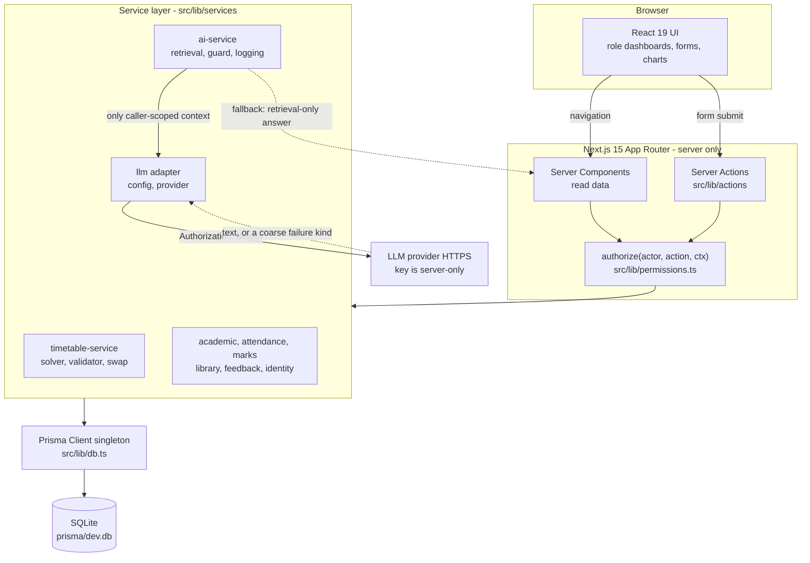

# Smart Campus Management System

A centralized, responsive web application for college administration, academics, student
services and light automation, with **separate dashboards for Administrators, Faculty and
Students**.

The application is a working, database-backed system — not a set of static screens. It is a
modular monolith built with Next.js (App Router), TypeScript, Prisma and SQLite, and it runs
locally with no external services required.

> **Demo data only.** Every record in the seeded database is fictional. No real institution,
> staff, student or credential data is included.

---

## Table of contents

1. [Problem statement and goals](#problem-statement-and-goals)
2. [Key features](#key-features)
3. [Technology stack](#technology-stack)
4. [Architecture](#architecture)
5. [Application modules and user roles](#application-modules-and-user-roles)
6. [AI assistant](#ai-assistant)
7. [Screenshots](#screenshots)
8. [Prerequisites](#prerequisites)
9. [Installation and setup (Windows PowerShell)](#installation-and-setup-windows-powershell)
10. [Environment variables](#environment-variables)
11. [Database setup](#database-setup)
12. [Running the development server](#running-the-development-server)
13. [Tests, type checking, linting and production build](#tests-type-checking-linting-and-production-build)
14. [Demo accounts](#demo-accounts)
15. [Project structure](#project-structure)
16. [Security and privacy](#security-and-privacy)
17. [Known limitations and future improvements](#known-limitations-and-future-improvements)
18. [Deployment](#deployment)
19. [Contributing](#contributing)
20. [License](#license)

---

## Problem statement and goals

College administration is usually spread across disconnected spreadsheets, notice boards and
paper registers. Staff re-enter the same information, students cannot easily see their own
attendance and results, and building a conflict-free timetable by hand is slow and
error-prone.

This project centralizes that work into one role-aware platform. Its goals are to:

1. Centralize administration, academics and student services in one application.
2. Give Administrators, Faculty and Students purpose-built dashboards with role-scoped access.
3. Manage people, courses, subjects, batches, classrooms, timetables, attendance, marks,
   assignments, examinations, notices and library records.
4. Generate a conflict-free timetable automatically, while keeping a human approval gate
   before anything is published.
5. Provide analytics and at-risk-student reporting.
6. Deliver in-app notifications and reminders.
7. Include a retrieval-grounded AI assistant that answers from authorized data only.
8. Support feedback and complaint handling.
9. Enforce role-based authorization **server-side** on every protected operation.
10. Stay responsive across desktop, laptop, tablet and mobile browsers.

The written requirements baseline lives in [`requirements/`](./requirements). Those documents
were authored as the pre-code planning baseline, so **they describe intended scope, not
proof of implementation**. This README distinguishes verified behaviour from planned work —
see [Key features](#key-features).

---

## Key features

### Implemented and working

| Area | What works |
|---|---|
| **Authentication & sessions** | Email / roll-number / institutional-ID sign-in, bcrypt password hashing (cost 12), server-side session records with idle + absolute expiry, failed-login tracking, sign-out, change-own-password. |
| **Role-based access control** | A single policy module (`src/lib/permissions.ts`) gates every protected action with `authorize(actor, action, ctx)`. Ownership, assignment and *published-only* scope rules are enforced in the service layer, not in the UI. |
| **Admin dashboard** | Institution overview, student/faculty management, academic structure (departments, courses, subjects, batches, classrooms), timetable generation/review/approval/publishing, attendance oversight, examinations, notices, analytics, audit log, system settings. |
| **Faculty dashboard** | Own timetable, attendance recording against class sessions, marks entry, assignment creation, course/batch notices, lecture-swap requests, lecture cancellation. |
| **Student dashboard** | Own published timetable, attendance history and percentage, published results, assignments, notices, library catalogue and borrowing, feedback and complaint submission, notification centre. |
| **Smart timetable generator** | Deterministic constraint solver (`src/lib/timetable/solver.ts`) honouring faculty availability and workload, classroom capacity and type, and batch clashes. Versions move through an explicit status machine; **publishing is impossible until an Admin approves** a conflict-free version. |
| **Lecture swaps & cancellations** | Faculty-to-faculty swap requests with accept/reject consent, plus cancellation of own published lectures, both with notifications. |
| **Attendance** | Attendance recorded per class session (present/absent), percentage computation, and configurable low-attendance threshold flagging. |
| **Examinations & results** | Exam scheduling, marks entry by assigned faculty, Admin-only result publishing, and students seeing **published results only**. |
| **Notices & notifications** | Role- and course/batch-targeted notices; in-app notification centre with read/unread state. Notifications are idempotent and are generated for: new notices, new assignments, low attendance, timetable publication and timetable changes, results publication, new complaints and complaint updates, lecture swaps and lecture cancellations. |
| **Library** | Searchable catalogue with availability status, borrowing and return tracking, and due dates. |
| **Feedback & complaints** | Student feedback and campus-issue reporting, Admin review and status updates, students tracking their own complaints. |
| **Analytics** | Institute attendance, batch attendance by subject, batch mark statistics, attendance trends, at-risk student identification, and per-student / per-faculty overviews. |
| **Audit logging** | Important actions are written to an audit log; logging failures never break the calling operation. |
| **AI assistant** | Retrieval-grounded Q&A over the caller's own records and admin-approved documents, with an optional LLM layer. See [AI assistant](#ai-assistant). |
| **UI/UX** | Responsive layout with collapsible side navigation, forms and tables with validation messages, charts, and loading/success/error/empty states. |
| **Security headers** | CSP and hardening headers applied to every route (`next.config.mjs`). |
| **Tests** | Vitest suite covering permissions, timetable state machine, attendance, workflows, notice links, demo-account consistency and the AI assistant. DB-backed tests run against an isolated `prisma/test.db`. |

### Planned / not implemented

These are **not** implemented. They are listed so the boundary is clear.

| Item | Status |
|---|---|
| Password reset / "forgot password" flow | Not implemented. An unused `PasswordResetToken` model exists in the schema; no service, action or page uses it. |
| Email and SMS delivery | Not implemented. `SMTP_URL` and `SMS_PROVIDER_KEY` exist as placeholders in `.env.example`; notifications are **in-app only**. |
| Report export (CSV/PDF download) | Not implemented. Analytics are view-only. |
| Library due-date reminders and exam reminders | Not implemented. `LIBRARY_DUE` and `ACCOUNT` are declared in the notification type list but are never emitted, and there is no scheduler — reminders are not sent on a timer. |
| Automated backups | Not implemented. |
| Student assignment file submission | Not implemented. Students view assignments and deadlines only. |
| Library fines and payments | Out of scope by design. Only due dates are tracked. |
| Payments, hostel, transport, payroll, placement | Out of scope. |
| OR-Tools / CP-SAT solver upgrade | Backlog idea only. |
| Multi-institution / multi-tenant support | Out of scope. |
| Linting / formatting configuration | Not configured. There is no ESLint, Prettier or Biome config and no `lint` script. |
| CI/CD pipeline | Not configured. There is no `.github/` directory. |

---

## Technology stack

| Layer | Choice |
|---|---|
| Framework | Next.js `^15.5.0` (App Router, React Server Components, Server Actions) |
| UI | React `^19.0.0`, React DOM `^19.0.0` |
| Language | TypeScript `^5.6.3`, `strict: true` |
| Styling | Tailwind CSS `^3.4.14`, PostCSS `^8.4.47`, Autoprefixer `^10.4.20` |
| Database | SQLite via Prisma `^6.0.0` / `@prisma/client` `^6.0.0` |
| Validation | Zod `^3.23.8` |
| Auth | bcryptjs `^2.4.3` + server-side session records in the database |
| Testing | Vitest `^2.1.4` |
| Script runner | tsx `^4.19.2` (runs `prisma/seed.ts`) |
| AI | Optional LLM provider with an OpenAI-compatible chat-completions API (Groq by default) |

The schema is written to be **Postgres-portable**, but SQLite is the only provider that has
been used and tested. SQLite has no native enums or `CHECK` constraints, so enum-like values
are stored as validated strings (enforced with Zod and in the service layer).

---

## Architecture

Reads happen in **React Server Components**; mutations happen in **Server Actions** under
`src/lib/actions/`. There are no `src/app/api` route handlers and no `middleware.ts`.

Every protected operation passes through the authorization policy before it reaches the
database. Service modules never trust the UI for permission decisions.



Key structural decisions:

- **Authorization is centralized.** `permissions.ts` encodes the role capability matrix and
  the scope rules (ownership, assigned faculty, published-only). See
  [Security and privacy](#security-and-privacy).
- **The timetable state machine is explicit.** `TIMETABLE_TRANSITIONS` in
  `src/lib/constants.ts` allows only `GENERATED → IN_REVIEW → APPROVED → PUBLISHED`, so a
  timetable can never be auto-published.
- **Attendance hangs off dated class sessions**, not timetable slots, so history stays
  correct when a timetable is later regenerated.
- **Notifications are idempotent** via an idempotency key, so repeated triggers do not
  duplicate messages.

---

## Application modules and user roles

Only three roles exist: **ADMIN**, **FACULTY**, **STUDENT**. Accounts are created by an
Administrator; there is no self-registration.

### Administrator — `/admin`

Full oversight: institution dashboard, students and faculty, academic structure, timetable
(generate → review → edit → approve → publish), attendance oversight, examinations, notices,
analytics and reports, audit log, and system settings (including the attendance threshold).

### Faculty — `/faculty`

Scoped to their own assigned subjects, batches and classes: own timetable, attendance
recording, marks entry, assignment creation, course/batch notices, lecture swaps, and lecture
cancellation. Faculty cannot publish timetables or results.

### Student — `/student`

Scoped to their own records: published timetable, attendance and percentage, published
results, assignments and deadlines, notices, library catalogue and borrowing, feedback and
complaint submission, and notifications. Students can never modify official attendance or
marks.

### Module map

| Module | Primary routes |
|---|---|
| Authentication | `/login`, `/account` |
| Admin dashboard | `/admin`, `/admin/users`, `/admin/academic`, `/admin/timetable`, `/admin/attendance`, `/admin/exams`, `/admin/notices`, `/admin/complaints`, `/admin/analytics`, `/admin/audit`, `/admin/settings` |
| Faculty dashboard | `/faculty`, `/faculty/timetable`, `/faculty/attendance`, `/faculty/attendance/[sessionId]`, `/faculty/marks`, `/faculty/assignments`, `/faculty/notices`, `/faculty/swaps` |
| Student dashboard | `/student`, `/student/timetable`, `/student/attendance`, `/student/results`, `/student/assignments`, `/student/notices`, `/student/library`, `/student/complaints` |
| Notifications | `/notifications` |
| AI assistant | `/assistant` (all three roles) |

32 application routes in total.

---

## AI assistant

The assistant at `/assistant` is **retrieval-grounded and read-only**. It is available to all
three roles and is scoped to whatever the signed-in user is allowed to see.

### How an answer is produced

1. **Confidentiality guard first.** A guard runs *before* retrieval and before any provider
   call, refusing requests that ask for another person's records.
2. **Retrieval.** Intent detection selects tools that query the database **already scoped to
   the caller** — for example attendance and results by the caller's own `studentProfileId`,
   timetable by the caller's own batch or faculty ID, assignments by the caller's batch, and
   knowledge documents filtered to `isApproved: true` only.
3. **Optional LLM.** If `LLM_API_KEY` is configured, the retrieved slice (capped at ~4000
   characters) and the question are sent to the provider as a system + user message pair. The
   system prompt instructs the model to answer only from the supplied context, to treat the
   context and question as untrusted data, never to reveal its instructions or any secret, and
   to stay read-only.
4. **Fallback.** If no key is configured, or the provider fails (timeout, rate limit,
   unavailable, bad response), the assistant degrades gracefully to a retrieval-only answer
   or a fixed "I don't have verified information" reply. Provider error bodies are never
   surfaced to the user.

The answer object reports provenance (`via`): `llm`, `retrieval`, `fallback` or `guard`, plus
the model name when an LLM answered. The UI shows this so an answer is never misrepresented.

### Prompt-injection and privacy boundaries

- **Enforced in code:** retrieval scoping, so another user's data is never fetched and never
  reaches the model; the LLM API key is read server-side only and sent **only** as an
  `Authorization: Bearer` header (never in the request body, logs, errors or response); the
  system turn is static, so user text cannot be prepended to it; provider errors are mapped to
  coarse kinds; the rate limit of 10 questions per user per minute.
- **Requested of the model (not code-enforced):** refusing to reveal the system prompt,
  ignoring instructions embedded in the context or question, and declining to claim it
  performed an action. These are instruction-level controls. The system prompt contains no
  secrets and no user data, so a model that ignores them cannot disclose data that was never
  retrieved.

### Configuration

The provider layer is provider-agnostic with an OpenAI-compatible adapter, defaulting to Groq.
Set `LLM_API_KEY` to enable it; `LLM_PROVIDER`, `LLM_MODEL`, `LLM_BASE_URL` and
`LLM_TIMEOUT_MS` are optional overrides. See [Environment variables](#environment-variables).

Leaving `LLM_API_KEY` empty is fully supported — the assistant then answers from retrieved data
only.

---

## Screenshots

**No screenshots are included in this repository.** None exist in the project, and none have
been fabricated here. To see the UI, run the application locally
(see [Installation and setup](#installation-and-setup-windows-powershell)) and sign in with a
demo account. The sign-in screen lists the demo accounts and displays the shared demo password
in development.

---

## Prerequisites

| Requirement | Notes |
|---|---|
| **Node.js** | Node.js 20 or newer recommended. This project was developed and verified on **Node.js 22.23.1**. |
| **npm** | npm 10 or newer. Verified with **npm 10.9.8**. Ships with Node.js. |
| **Operating system** | Developed and verified on Windows with PowerShell. Any OS that runs Node.js should work; the commands below are PowerShell. |
| **Git** | Optional, only to clone the repository. |
| **Database** | None to install. SQLite is embedded and the database file is created locally. |
| **LLM API key** | Optional. Only needed for the LLM-powered assistant; the assistant works without it. |

---

## Installation and setup (Windows PowerShell)

```powershell
# 1. Clone the repository
git clone https://github.com/darshkheni007/DevSprint_Hack.git
Set-Location DevSprint_Hack

# 2. Install dependencies
npm install

# 3. Create your local environment file from the template
Copy-Item .env.example .env

# 4. Edit .env and set SESSION_SECRET to a long random value
#    Generate one with:
#    node -e "console.log(require('crypto').randomBytes(48).toString('base64url'))"

# 5. Generate the Prisma client, create the SQLite database and seed demo data
npm run setup

# 6. Start the development server
npm run dev
```

Then open <http://localhost:3000> and sign in. The sign-in screen lists the demo login
identifiers in development.

> `npm run setup` runs `prisma generate`, `prisma db push` and the seed script. Running it
> again **clears and recreates** the demo dataset.

---

## Environment variables

All variables are documented in [`.env.example`](./.env.example). Copy it to `.env` — the real
`.env` is git-ignored and must never be committed.

| Variable | Required | Purpose |
|---|---|---|
| `DATABASE_URL` | Yes | Prisma connection string. Default `file:./dev.db`. Relative SQLite paths resolve **against the `prisma/` directory**, so this file is `prisma/dev.db`. |
| `SESSION_SECRET` | Yes | Signing secret for session cookies. Use a long random value; never reuse a placeholder. |
| `SESSION_IDLE_MINUTES` | Yes | Idle session timeout in minutes. |
| `SESSION_ABSOLUTE_MINUTES` | Yes | Maximum session lifetime in minutes. |
| `ATTENDANCE_THRESHOLD_PERCENT` | Yes | Percentage below which attendance is flagged, e.g. `75`. |
| `SMTP_URL` | Optional | Reserved for email delivery. **Not implemented** — leave blank. |
| `SMS_PROVIDER_KEY` | Optional | Reserved for SMS delivery. **Not implemented** — leave blank. |
| `LLM_API_KEY` | Optional | Enables the LLM-backed assistant. Leave empty for retrieval-only answers. |
| `LLM_PROVIDER` | Optional | Provider identifier. Defaults to `groq`. |
| `LLM_MODEL` | Optional | Model name override. |
| `LLM_BASE_URL` | Optional | OpenAI-compatible base URL override (commented out in the template). |
| `LLM_TIMEOUT_MS` | Optional | Provider request timeout in milliseconds. Defaults to 15000. |

Notes:

- **These values are server-only.** None of them are prefixed with `NEXT_PUBLIC_`, so none are
  exposed to the browser bundle.
- **Never commit `.env`.** It is already listed in `.gitignore`, along with `.env.*`
  (`.env.example` is explicitly kept).
- If `LLM_API_KEY` is missing or invalid, the assistant still works and answers from retrieved
  data only.

---

## Database setup

The project uses **`prisma db push`**, not `prisma migrate`. There is no `prisma/migrations`
directory, so no migration files need to be generated or applied.

| Command | What it does |
|---|---|
| `npm run db:generate` | Regenerates the Prisma client into `node_modules` (`prisma generate`). |
| `npm run db:push` | Creates/updates the SQLite schema from `prisma/schema.prisma` (`prisma db push --skip-generate`). |
| `npm run db:seed` | Runs `prisma/seed.ts`, which **clears the demo tables** and recreates the fixed demo dataset. |
| `npm run setup` | Convenience: `db:generate` + `db:push` + `db:seed`. |
| `npm run db:reset` | **Destructive.** `prisma db push --force-reset` (drops the database) followed by a reseed. |

> **Warning.** `db:seed`, `setup` and `db:reset` overwrite the local demo dataset. Do not run
> them if you have hand-edited records you want to keep.

The seeded demo dataset contains: 1 active academic term, 4 departments, 3 B.Tech courses,
11 subjects, 8 classrooms, 4 student batches, 6 daily periods, 1 Administrator, 6 Faculty and
40 Student accounts, with subject offerings and a generated timetable.

For testing, the database is a **separate disposable file**: `tests/global-setup.ts` runs
`prisma db push --force-reset` against `file:./test.db` (i.e. `prisma/test.db`) before the
suite. Your `prisma/dev.db` demo data is never touched by the test suite.

---

## Running the development server

```powershell
npm run dev
```

The application is served at <http://localhost:3000>.

For a production-mode run locally:

```powershell
npm run build
npm run start
```

---

## Tests, type checking, linting and production build

| Task | Command | Notes |
|---|---|---|
| Tests (single run) | `npm test` | Runs `vitest run`. 9 test files. |
| Tests (watch mode) | `npm run test:watch` | Runs `vitest` in watch mode. |
| Type checking | `npm run typecheck` | Runs `tsc --noEmit`. |
| Production build | `npm run build` | Runs `next build`. |
| Linting | *Not available* | No ESLint, Prettier or Biome configuration exists and no `lint` script is defined in `package.json`. Do not expect `npm run lint` to work. |

Recommended verification order before committing:

```powershell
npx prisma validate
npm run typecheck
npm test
npm run build
```

Notes:

- `npm test` resets `prisma/test.db` and runs files sequentially (`fileParallelism: false`),
  because SQLite serialises writers.
- The test suite does not require network access. LLM tests stub the HTTP layer.
- If the development server is running while you build, stop it first — `next build` writes to
  `.next`, which the dev server holds open.

---

## Demo accounts

The seed creates 40 student accounts, 6 faculty accounts and 1 administrator account. All
share one demo password.

| Role | Example login ID | Also accepted |
|---|---|---|
| Administrator | `adm001` | `admin@campus.edu` |
| Faculty | `fac001` (`fac001`–`fac006`) | e.g. `ananya.rao@campus.edu` |
| Student | `cse-26a-001` (roll numbers `cse-26a-001` … `cse-26b-010`, `ece-26a-001` …, `me-26a-001` …) | e.g. `student001@campus.edu` |

Sign in with an **email, roll number or institutional ID**.

The shared demo password is **not reproduced in this README**. It is displayed on the sign-in
screen when the app is not running in production (`NODE_ENV !== "production"`) and is defined
in `src/lib/demo-accounts.ts`. Changing the demo password requires editing that file and
resetting your local database, so treat it as **local demo data only**.

> These accounts are fictional fixtures. Do not reuse the demo password for anything real, and
> do not enable the demo-credential panel in a production deployment.

---

## Project structure

```
.
├── prisma/
│   ├── schema.prisma          # 36 models: identity, academics, timetable, attendance,
│   │                          #   marks, notices, library, feedback, assistant, audit
│   ├── seed.ts                # Deterministic, idempotent demo data
│   ├── dev.db                 # Local demo SQLite database (git-ignored)
│   └── test.db                # Disposable test database (git-ignored)
├── requirements/              # Pre-code requirements baseline (00–07)
│   ├── 00-project-scope.md
│   ├── 01-architecture.md
│   ├── 02-security-requirements.md
│   ├── 03-testing-and-quality-gates.md
│   ├── 04-agent-workflow.md
│   ├── 05-acceptance-criteria.md
│   ├── 06-decisions-and-deviations.md
│   └── 07-engineering-improvement-log.md
├── src/
│   ├── app/
│   │   ├── layout.tsx         # Root layout
│   │   ├── page.tsx           # Entry point (redirects by role)
│   │   ├── login/             # Sign-in page
│   │   └── (dashboard)/       # Authenticated shell + all role dashboards
│   │       ├── admin/         # Administrator routes
│   │       ├── faculty/       # Faculty routes
│   │       ├── student/       # Student routes
│   │       ├── assistant/     # AI assistant
│   │       ├── notifications/ # Notification centre
│   │       └── account/       # Own profile and password
│   ├── components/            # Shell, forms, tables, charts, icons, timetable grid, UI kit
│   └── lib/
│       ├── actions/           # Server Actions — the only mutation entry points
│       ├── services/          # Business logic, incl. services/llm/ (provider adapter)
│       ├── timetable/         # solver, validator, occurrence, swap logic
│       ├── permissions.ts     # Central authorization policy
│       ├── guard.ts           # Request guards
│       ├── session.ts         # Session creation/validation
│       ├── validation.ts      # Zod schemas
│       ├── db.ts              # Prisma client singleton
│       ├── constants.ts       # Roles, statuses, state machine, periods
│       ├── notifications.ts   # Idempotent notification creation
│       └── audit.ts           # Audit logging
├── tests/                     # Vitest suites (9 test files) + fixtures and global setup
├── .env.example               # Documented environment template (safe placeholders only)
├── next.config.mjs            # Security headers, strict mode
├── tailwind.config.ts         # Design tokens
├── vitest.config.ts           # Test config (isolated test database)
└── package.json
```

---

## Security and privacy

**Authentication.** Passwords are hashed with bcrypt (cost 12). Sessions are stored server-side
with both idle and absolute expiry, and failed sign-in attempts are recorded.

**Authorization.** All protected operations go through `authorize(actor, action, ctx)` in
`src/lib/permissions.ts`. The policy combines a role capability matrix with scope rules:

- **Ownership** — students and faculty act on their own records.
- **Assignment** — faculty may record attendance, enter marks and create assignments only for
  subject offerings assigned to them.
- **Consent** — only the nominated recipient of a swap request may accept or reject it.
- **Published-only** — students and faculty see timetables, assignments, exams and results only
  once they have been published; unreleased data is not readable.

Because these rules are evaluated in the service layer, they apply regardless of how the
request was made.

**Data protection.** Student and faculty records are readable only within the scope above.
SQLite stores data in a local file; protect the file and the host, and do not commit
`prisma/dev.db`.

**AI privacy boundaries.** See [AI assistant](#ai-assistant). In short: retrieval is scoped to
the caller before the model is involved, the provider key is server-side and header-only, the
system prompt contains no secrets, and provider failures degrade to retrieval-only answers.

**Transport and browser hardening.** `next.config.mjs` applies to every route:
`X-Content-Type-Options: nosniff`, `X-Frame-Options: DENY`, `Referrer-Policy:
strict-origin-when-cross-origin`, `X-DNS-Prefetch-Control: off`, a `Permissions-Policy` that
disables camera/microphone/geolocation, and a Content-Security-Policy with
`default-src 'self'`, `connect-src 'self'`, `frame-ancestors 'none'` and `form-action 'self'`.
`poweredByHeader` is disabled and React strict mode is on.

**Secrets.** Secrets live only in `.env`, which is git-ignored. `.env.example` contains
placeholders only. No environment variable is exposed to the browser.

### Known security limitations

- The Content-Security-Policy includes `'unsafe-inline'` and `'unsafe-eval'` in `script-src`,
  which weakens defence-in-depth against XSS. There are currently no HTML-injection sinks in
  the codebase, but a nonce-based policy would be stronger.
- No `Strict-Transport-Security` header; add HSTS at the TLS terminator when deploying.
- The assistant's confidentiality guard is a heuristic that runs before retrieval. It is a
  usability layer, **not** the authoritative control — the authoritative control is
  caller-scoped retrieval.
- Knowledge documents are filtered by approval status but not by role, so any approved
  document is readable by every signed-in role. Do not store role-specific documents without
  extending the schema.
- Assistant questions are stored in plaintext in the query log for the asking user's own
  history. Do not type secrets into the assistant.
- The assistant rate limit (10 questions per user per minute) is per account and not atomic.

---

## Known limitations and future improvements

Current limitations:

- SQLite only; concurrent write throughput is limited by SQLite's single-writer model.
- Timetable generation is a deterministic constraint solver, not an optimizer — it finds a
  valid schedule, not necessarily the best one.
- Notifications are in-app only; there is no email or SMS delivery.
- No password reset flow, no report export, no automated backups.
- No linting configuration and no CI pipeline.
- The test suite is Node-only; there are no browser or end-to-end UI tests in the repository.

Candidate improvements (from `requirements/07-engineering-improvement-log.md` and the security
review of this codebase):

1. Add a nonce-based CSP and HSTS.
2. Replace the assistant confidentiality heuristic's identifier comparison with the caller's
   real login/roll identifier, or remove the heuristic in favour of scoped retrieval.
3. Add an assistant evaluation set (question → expected grounded answer or refusal).
4. Add rate limiting that also covers IP and total provider spend.
5. Upgrade the solver to OR-Tools CP-SAT for larger inputs.
6. Add email/SMS notification adapters behind the existing notification interface.
7. Exportable analytics reports.
8. Student assignment file submission.
9. Linting and a CI pipeline running typecheck, tests and build.
10. A Postgres deployment path with real migrations.

---

## Deployment

**No deployment target is configured for this repository.** There is no Dockerfile, no
`vercel.json`, no platform manifest and no CI workflow, so no deployment has been performed or
verified.

A production server can be run locally with the scripts that exist:

```powershell
npm install
Copy-Item .env.example .env   # then set real values, including a strong SESSION_SECRET
npm run build
npm run start                 # serves the production build on http://localhost:3000
```

If you deploy this application, note that:

- The database is a **local SQLite file**, so hosting must provide persistent, writable disk.
  Ephemeral or multi-instance hosts will lose or split the database.
- The schema is written to be Postgres-portable, but **Postgres has not been tested**. Switching
  providers requires changing the `datasource` in `prisma/schema.prisma`, supplying a
  `DATABASE_URL`, generating a client, and creating the schema.
- Set a strong, unique `SESSION_SECRET` and never reuse the placeholder.
- Serve over HTTPS and add HSTS.
- The demo credential panel on the sign-in page is disabled automatically when
  `NODE_ENV=production`; verify this before exposing the app publicly.

---

## Contributing

This repository has no `CONTRIBUTING.md`, no issue templates and no pull-request process
defined, and it is not configured to accept external contributions.

If you want to work on it:

1. Create a branch.
2. Keep the requirements baseline in `requirements/` in mind — it describes intended scope, and
   changes to requirements or permissions are meant to be recorded in
   `requirements/06-decisions-and-deviations.md` rather than applied silently.
3. Run the verification sequence before opening a change:

   ```powershell
   npx prisma validate
   npm run typecheck
   npm test
   npm run build
   ```

4. Never commit `.env`, credentials or database files.

---

## License

**No license has been specified for this project.** No `LICENSE` file is present in the
repository, so no license is granted and all rights are reserved by the author by default.

If you intend to reuse, distribute or contribute to this code, contact the repository owner
(<https://github.com/darshkheni007>) to agree on licensing terms first.

---

## Acknowledgements

Built with Next.js, React, TypeScript, Tailwind CSS, Prisma and Vitest. The AI assistant uses
an OpenAI-compatible chat-completions provider (Groq by default) and is entirely optional.
